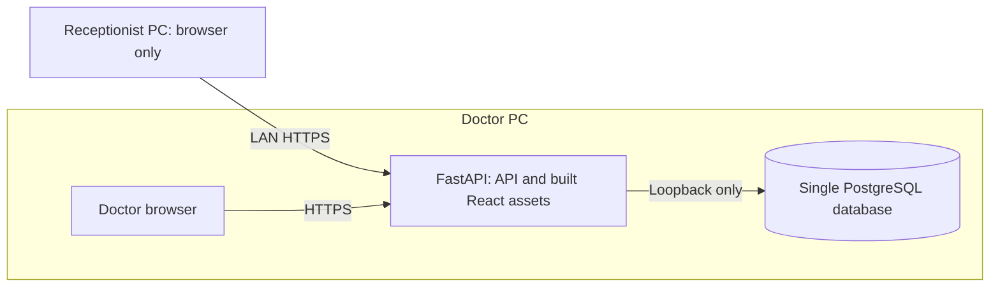

# ADR-001: Modular monolith on the doctor's PC

Status: Accepted for the fixed product constraints and baseline design below. Open implementation choices are explicitly listed at the end. Date: 2026-10-23. Task: [0A](../tasks/0A.md).

The clinic has one Neurology & Psychiatry doctor and one receptionist PC. Use an original Arabic RTL React + TypeScript application backed by a FastAPI modular monolith and one PostgreSQL database on the doctor's PC. The receptionist uses a browser over LAN HTTPS; the same application serves the doctor's browser locally. This keeps operations and transactions on one machine while enforcing distinct user permissions centrally.

## Topology and ownership

- The doctor PC is the sole application host and data authority. The receptionist installs no Python, Node, PostgreSQL, local database or background server.
- Production uses one origin for the built UI and `/api/v1` routes, served by the FastAPI deployment. A React development server is development-only.
- HTTPS terminates on the doctor PC. Baseline: the ASGI host provides TLS directly; validate its Windows service integration before deployment. Do not add a proxy or another host without a recorded need and ADR update.
- PostgreSQL binds to loopback only. The LAN firewall exposes only the configured HTTPS port, restricted to the clinic network. No public internet port forwarding. Do not treat IP address restrictions as user authorization.
- The doctor can work while the receptionist is disconnected. Neither PC can perform server-backed work while the doctor PC/application/database is down. No offline queue, second database or synchronization is planned.

## Internal boundaries

One codebase and deployment, with internal modules for identity/access, patients, scheduling, clinical visits, billing and audit. These are logical boundaries, not services. Each module owns its validation and writes; cross-module use goes through application services inside the same process. Shared PostgreSQL transactions cover changes that must succeed together. No message broker, Redis, cloud identity service or separate reporting server is required.

Patients own demographics; scheduling references patient identity; visits own doctor-only clinical content; billing owns charges and payment records. Billing receives only an administrative service label and patient/visit references, not diagnoses or clinical text. Audit events record actor, action, object identifier, time and outcome without copying notes or request bodies. See the authoritative [permission matrix and data boundaries](../requirements/MVP.md).

An appointment is not a visit, and an invoice is not a payment. See the [glossary](../../GLOSSARY.md). Record new decisions here or in later ADRs; do not derive our architecture, permissions or data model from the reference project's stack.

## Authentication and authorization baseline

- Separate named doctor and receptionist accounts; no shared credentials and no self-selected roles. A session works according to its account role regardless of which PC opens it.
- Use opaque server-managed sessions stored in PostgreSQL. Passwords are salted adaptive hashes through a maintained library. Pin and verify the library and settings in the authentication task; never invent password cryptography.
- Deployed session cookies are HttpOnly, Secure and SameSite, with server-side expiry and revocation. Require CSRF protection and trusted-origin validation on cookie-authenticated mutations. Do not store bearer tokens or clinical records in browser local storage.
- The API denies unauthenticated access and checks role/action permissions on every operation. Separate response and input allowlists prevent clinical leakage and receptionist mass-assignment of privileged fields. Client-supplied roles, totals or audit actors are not authoritative.
- Doctor-only account administration creates/disables receptionist access. Initial doctor setup is a local operator operation with a one-time credential process, not a public registration endpoint or a default password. Disabled accounts lose existing sessions.
- Audit denied access, account changes, demographic changes, clinical record access/finalization and financial changes. Audit access is doctor-only; routine UI cannot edit audit history.

## Secrets and data strategy

- Task 0A creates no credentials, `.env` files, keys, databases or seed records. All future development, screenshots, fixtures and demonstrations use synthetic data only.
- Task 0B must establish ignore rules before introducing configuration: `.env` variants except a safe `.env.example`, private keys/certificates, database dumps, backups, logs and local data directories. Example values must be visibly inert placeholders. Never place secrets in React build variables, compiled assets, source, logs or command-line arguments.
- Local development loads untracked configuration outside committed source. Deployment stores configuration and TLS keys outside the checkout under Windows ACLs readable only by the service identity and authorized operator. Use a least-privilege application DB account and a distinct migration credential available only to the local migration operation.
- Generate unique credentials during setup; no reusable default credentials. Document rotation of database credentials, session secrets (if used), bootstrap credentials and TLS keys. Rotation must revoke affected sessions as appropriate.
- Use a clinic-controlled certificate authority or another explicitly trusted certificate source for the fixed LAN hostname. Install only public trust material on the receptionist PC; private keys remain on the doctor PC. No browser certificate-warning bypasses. Certificate provisioning, renewal and expiry checks must be documented and tested.
- The Windows deployment must include encrypted, access-controlled backups and a tested restore to an isolated disposable database. Backup media is storage, not another application server. Do not put encryption keys beside exported backups. Choose the recovery objectives, retention and key custody before deployment; no production restore or destructive migration without approval.
- Avoid patient data in URLs, telemetry, error details, request logs and persistent browser caches. Authorized printouts/receipts are explicit outputs, not unrestricted clinical exports. No third-party telemetry or remote integrations in the MVP.

## Localhost development decision

Future Task 0B uses React + TypeScript with Vite on `127.0.0.1:5173`, FastAPI on `127.0.0.1:8000`, and PostgreSQL on `127.0.0.1:5432`. Use one browser origin via a development `/api` proxy. A local PostgreSQL instance must contain only the dedicated synthetic development/test databases. Tests must fail safely if pointed at an unapproved database.

Loopback HTTP is an explicit development-only exception. Any non-loopback access requires HTTPS; a future development cookie exception must be impossible to enable in deployment mode. Bind development services to loopback, not `0.0.0.0`. Local HTTP tests cannot establish LAN TLS or Secure-cookie acceptance. Dependencies and supported Python/Node/PostgreSQL versions will be pinned in 0B after compatibility checks. Alembic is the migration authority; no automatic schema creation on normal application startup.

There is no runnable application in 0A. The above ports and commands to be added in 0B are design decisions, not claims that servers or scripts exist.

## Future Windows deployment decision

Target native Windows services on the doctor PC: PostgreSQL plus the packaged FastAPI/ASGI application with prebuilt React assets. No Node development server at runtime and no runtime container requirement. Select and test a maintained Windows service wrapper in the deployment task. Run under a dedicated least-privilege identity, start automatically after dependencies, and verify reboot recovery, sleep policy, shutdown, update rollback and local diagnostics.

Use a stable private address/reservation and a stable LAN hostname matching the TLS certificate. The doctor browser uses the same trusted HTTPS hostname. The receptionist receives a browser shortcut and public CA trust only. Installations, firewall/trust changes and deployment to either real PC require approval. Windows installation, printing and LAN HTTPS have not been tested in 0A.

## Consequences and alternatives

This avoids distributed deployment and cross-machine database coordination but makes the doctor PC a single point of failure. Backup/restore, power/sleep configuration and restart behavior are release gates. The monolith requires deliberate module boundaries and API response filtering; merely hiding a UI tab is insufficient. Receptionist access to demographic and financial information remains sensitive even when clinical notes are withheld.

Rejected for this scope: cloud hosting, extra server machines, microservices, a receptionist database, offline synchronization and importing the reference application's framework/modules. These contradict the fixed product scope or add operational burden without a single-doctor requirement.

## Unresolved decisions and deadlines

| Decision | Owner / deadline | What blocks completion |
| --- | --- | --- |
| Supported runtime versions, package manager and dependency pins | Implementation task 0B | Reproducible scaffold acceptance |
| Password library/settings, session idle/absolute durations and local recovery procedure | Authentication task 0C; clinic owner for durations | Authentication acceptance |
| Windows versions, service wrapper, TLS provisioning/renewal and hostname | Deployment task 0D with clinic operator | Windows/LAN deployment approval |
| Backup schedule, recovery time/data-loss objectives, retention and key custody | Clinic owner before 0D acceptance | Operational release; no invented policy |
| Clinic timezone, currency, receipt numbering and any applicable billing obligations | Clinic owner before scheduling/billing implementation | Feature specifications; Cairo and EGP are candidates, not confirmed decisions |
| Minor/guardian handling, record retention, correction and export policy | Clinic owner before relevant clinical/export features | Relevant feature acceptance and live-data release |

These items do not block this documentation task. No deployment or legal/compliance certification is implied. Track scope and future acceptance gates in the [MVP](../requirements/MVP.md) and [STATUS](../STATUS.md).
