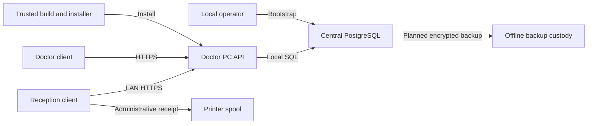

# Task 6A threat model — 2026-10-24

## Executive summary

The application has explicit API role checks and separate clinical projections. A confirmed high-priority availability weakness—unbounded request buffering outside login—was fixed. No critical authorization bypass was confirmed. The largest unresolved deployment risks are theft of the doctor workstation or backups, untrusted installer delivery, and incorrect LAN/TLS/database configuration. These are conditional risks, not claims about a deployed system. See [findings](FINDINGS.md), [endpoint matrix](ENDPOINT_MATRIX.md), and [test evidence](../tasks/6A.md).

## Scope and assumptions

Reviewed `backend/app`, API tests, frontend rendering/API clients, bootstrap, and deployment instructions. The user's explicit context establishes two Windows PCs, one doctor and central PostgreSQL on the doctor PC, client-only reception, LAN HTTPS, no public registration, and no Internet requirement during operation. Ubuntu and disposable synthetic databases are the current verification environment. No external systems were attacked; no secret files or real records were opened.

Windows services, pywebview packaging, installer signing, disk encryption, firewall rules and backups are not implemented/verified here. Their presence is not assumed. Open deployment questions: Windows editions and BitLocker availability; installer signing/trust distribution; backup destination, key custodian, retention and restore objectives; authorized receptionist provisioning and emergency account recovery. These affect operational severity but do not block auditing the existing API. This is a single-clinic model: staff may access all administrative patients, and the sole doctor may access all clinical visits. Per-doctor ownership isolation is not a product requirement.

## System model

### Primary components

FastAPI modular monolith (`backend/app/main.py:create_app`), PostgreSQL through SQLAlchemy (`core/db.py:build_engine`), React/Vite client (`frontend/src/App.tsx`), local doctor bootstrap (`backend/app/bootstrap.py`), and future Windows launcher/services described in ADR-001. No runtime cloud payment or third-party EMR integration was found.

### Data flows and trust boundaries

- Doctor/reception browser → API: credentials, cookies, CSRF tokens, PII and role-permitted records over planned same-origin HTTPS. `api/auth.py:require_user/require_role` verifies active account, session, origin and CSRF on writes. Pydantic input/output schemas validate fields; body middleware bounds pre-validation buffering.
- API → local PostgreSQL: bound SQL parameters and a server-only connection secret; authorization is enforced by API, not per-user database accounts. `core/db.py` hides parameters and limits query time/pool size. Production role grants remain an operator responsibility.
- Local operator → bootstrap/database: trusted interactive console, getpass, Argon2 and advisory-lock singleton bootstrap. Reception has no legitimate server/database credential.
- Browser → screen/print spool: administrative receipts and doctor-visible notes; React escapes text. No clinical export is enabled. Printer spool/browser memory/OS access remain outside API authorization.
- Build/operator → future Windows packages: privileged artifact installation; supply-chain and signing controls require Windows evidence.
- Doctor database → future backup media: all clinical records and audit history cross into a separate custody boundary; encrypted backup and isolated restore are requirements in ADR-001, not existing verified controls.

#### Diagram

## Assets and security objectives

| Asset | Why it matters | Objective |
| --- | --- | --- |
| Private notes and revision history | Exposure can cause lasting personal harm | C/I |
| Patient identity/contact data | Reception access is limited to administrative purposes | C/I |
| Sessions/password hashes/TLS and DB secrets | Theft grants access or defeats boundaries | C/I |
| Appointments and financial ledger | Availability and reliable records support clinic operation | I/A |
| Audits/backups/installers | Recovery, attribution and code integrity | C/I/A |

## Attacker model

### Capabilities

A compromised LAN host can make arbitrary HTTP requests. An authenticated receptionist can alter API paths, IDs, bodies and headers regardless of UI. A thief may obtain an unlocked client or offline disks. A malicious artifact distributor can replace an unsigned installer. A malicious website can attempt cross-origin requests, but cannot legitimately read same-origin cookies/CSRF responses.

### Non-capabilities

LAN access alone does not imply a valid session, TLS private key, OS administrator privilege or database access. A local administrator or malware on the doctor PC already bypasses API controls; role checks cannot protect a database from its host administrator. Internet reachability is excluded by the product decision, not proven by local tests.

## Entry points and attack surfaces

| Surface | How reached | Boundary | Notes / evidence |
| --- | --- | --- | --- |
| Every API route | LAN HTTP client | Client/API | Explicit inventory and executable policy in ENDPOINT_MATRIX.md and tests/test_security.py |
| Health, CSRF, login | No authenticated user | Public/API | api/health.py; api/auth.py:94–129; origin/throttle applies to CSRF/login |
| OpenAPI/docs/redoc | Default FastAPI URLs | Public/API metadata | main.py:31; public schema, not records; production restriction pending |
| Bootstrap | Local terminal | Operator/database | bootstrap.py:16–60; no password CLI argument/public registration |
| Text rendering/receipt | Stored API values | Data/browser DOM | VisitsPage.tsx and BillingPage.tsx use text interpolation, no raw HTML sink found |
| Logs and errors | Server/DB/OS operators | Runtime/operator | main.py:33–49; core/db.py; README no-access-log; audit payloads are metadata |
| Installer/backup | Future local operations | Supply chain/storage | ADR-001:44–48,63; no desktop implementation present |

## Top abuse paths

1. LAN attacker sends large chunked bodies → parser buffers before authorization → sole API memory exhaustion. Fixed per-request byte limit; concurrency/slow-client limits remain deployment concerns.
2. Reception guesses a visit ID or requests history/search/export directly → attempts clinical exfiltration. Doctor dependency denies before object lookup, verified with real and missing IDs.
3. Malicious website posts using doctor cookies → attempts unauthorized write. Strict SameSite cookies plus exact origin and synchronizer token checks block the tested path.
4. Thief obtains an unlocked doctor PC/session or unencrypted disk → reads clinical data outside intended access. Idle/absolute session expiry helps only the browser boundary; OS lock/encryption is required.
5. Attacker replaces an installer → service executes tampered code → total host/database compromise. Signing and verified distribution must be validated on Windows.
6. Backup media is lost or ransomware reaches backups → confidential history exposed or recovery impossible. Separate encryption keys and offline tested recovery required.
7. Operator enables verbose HTTP/SQL/request logging → searches or notes enter logs. Existing startup guidance disables access logs and code hides SQL parameters; deployment logging still needs inspection.
8. Reception supplies HTML/SQL metacharacters in administrative input → attempts script execution or query manipulation. Reviewed React text rendering and bound SQL expressions provide controls; no confirmed injection chain found.

## Threat model table

| ID | Source | Prerequisites | Action | Impact | Assets | Existing controls | Gaps | Mitigation | Detection | Likelihood | Impact severity | Priority |
| --- | --- | --- | --- | --- | --- | --- | --- | --- | --- | --- | --- | --- |
| TM-001 | LAN attacker | API reachable | Huge request bodies | Service outage | Availability | New RequestBodyLimit | Slow/concurrent clients still possible | Windows server connection/time limits | Metadata-only 413/resource metrics | medium | high | high |
| TM-002 | Reception | Valid low-role account | Guess clinical IDs/search/export | Note disclosure | Notes | api/visits.py Doctor dependency; tests/test_visits.py | Future routes can omit checks | Maintain exhaustive route test | authorization_denied audits | low | high | medium |
| TM-003 | Website/LAN attacker | Victim session or password guesses | CSRF/session theft/guessing | Account misuse | Credentials/records | auth.py origin/CSRF; services/auth.py Argon2, TTL, throttle | No operator session-revoke UI; workstation compromise | Define local recovery/revocation; OS lock | Login/denial audits | low | high | medium |
| TM-004 | Workstation thief | Physical/OS access | Read unlocked app or disk | Full disclosure | DB/secrets | Session expiry; planned secrets custody | Encryption/ACLs unverified | BitLocker, restricted service accounts, screen lock | OS security events | medium conditional | high | high |
| TM-005 | Artifact attacker | Alter distribution | Tamper with installer | Privileged code execution | All | Locked frontend dependencies; ADR packaging plan | No signed package evidence | Signed Windows artifacts, verify publisher/hash from independent trusted source | Installer signature checks | medium conditional | high | high |
| TM-006 | Thief/ransomware | Backup media access | Steal/delete backup | Exposure/unrecoverable loss | Notes/backups | ADR-001 backup requirement | No restore/encryption evidence | Offline encrypted rotation; separate key custody; isolated restore drill | Backup/restore verification log without PII | medium conditional | high | high |
| TM-007 | Operator error | Logging/trust misconfiguration | Log PII or expose DB/plain HTTP | Disclosure | PII/secrets | no-access-log guidance, hide_parameters, HTTPS cookies | Actual Windows service configuration unknown | Loopback DB, firewall API only, trusted CA, redact OS/proxy logs | Configuration review | medium conditional | high | high |
| TM-008 | Authenticated attacker | Malicious text input | XSS/SQL injection | Data theft/tamper | Records/session | React escaping; SQLAlchemy binding | No production CSP; clinical history unpaginated | Production CSP at document origin; bound history retrieval later | Metadata-only errors | low | high | medium |

## Criticality calibration

Critical: unauthenticated clinical dump or remotely executable host code. High: pre-auth sole-server resource exhaustion, stolen unencrypted clinical backup, tampered privileged installer. Medium: targeted throttle lockout, unbounded authenticated history retrieval, missing production browser hardening without an injection sink. Low: public API schema or non-sensitive health status. Deployment risks are conditional; no critical exploit was confirmed. Unbounded-body severity reflects the central server's availability role; no destructive load test was performed.

## Focus paths for security review

| Path | Reason | Threats |
| --- | --- | --- |
| backend/app/api/auth.py and services/auth.py | CSRF/session/throttle chokepoints | TM-003 |
| backend/app/api/visits.py and schemas/visit.py | Private serialization and direct API checks | TM-002 |
| backend/app/core/request_limits.py | Pre-auth resource boundary | TM-001 |
| backend/app/bootstrap.py | Local account trust boundary | TM-003,004 |
| backend/app/core/db.py and repositories | Secret/SQL boundary | TM-007,008 |
| frontend/src/VisitsPage.tsx and BillingPage.tsx | DOM, receipt and in-memory private data | TM-008 |
| docs/architecture/ADR-001.md | Pending Windows/backup/installer controls | TM-004–007 |

## Notes on use

Reviewed all discovered application API entry points and separated public metadata routes, developer tools, local bootstrap and future deployment. Tests exercise server authorization, not UI hiding. Trusted single-doctor context comes directly from the user's specification; operational unknowns remain explicit above. No certification, legal compliance or production readiness is asserted. Next task: 6B.
